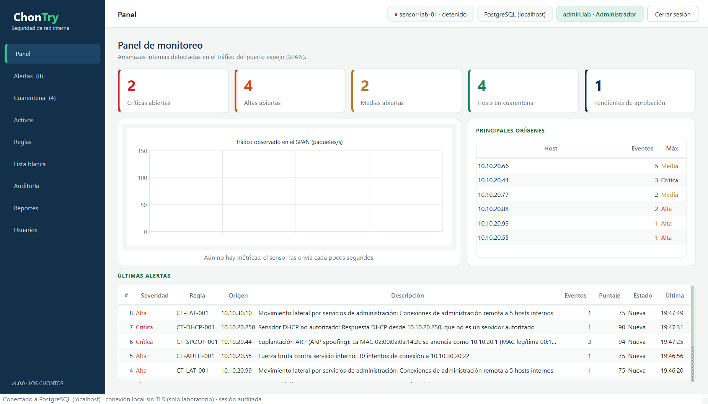

# ChonTry

**IDS/IPS agentless para amenazas internas en redes LAN** — equipo **LOS CHONTOS**
(Seguridad en Redes · OVA «Herramienta de Seguridad en Redes desde Cero»).

ChonTry escucha una copia del tráfico desde el **puerto espejo (SPAN)** del switch, detecta escaneos, movimiento lateral, fuerza bruta y suplantación ARP/DHCP, y **aísla al atacante** moviendo su puerto a una **VLAN de cuarentena**, de forma automática o con aprobación de un administrador. Todo se gestiona desde una **consola de escritorio** con autenticación de dos factores y auditoría inalterable.



## Componentes

| Componente | Qué hace |
|---|---|
| **Sensor** (`python -m sensor`) | Captura pasiva (Scapy + BPF), 7 reglas de detección, evidencias pcap cifradas, contención por SSH (Netmiko) con huella fijada, buffer cifrado si se cae la conexión. Corre sin root |
| **Consola** (`python -m consola`) | Escritorio (PySide6): panel, alertas, cuarentena, activos, reglas, lista blanca, auditoría, reportes y usuarios. Login Argon2id + TOTP de un solo uso |
| **Base de datos** (PostgreSQL / Neon) | Roles por perfil, seguridad por filas, triggers de autorización y auditoría encadenada con SHA-256 |
| **Herramienta de administración** (`python -m herramientas.admin`) | Migraciones, logins por persona, usuarios, sensores, switches y clave maestra |

## Inicio rápido

```powershell
git clone https://github.com/<usuario>/chontry.git
cd chontry
.\instalar.bat                 # crea .venv e instala dependencias con versión fija
# edite .env (ver docs/manual_instalacion.md)
.\ChonTry.bat                  # abre la consola
```

¿Sin base de datos todavía? En la pantalla de acceso elija **Demostración**. Para probar el sistema completo en un solo PC, monte el [laboratorio local](docs/manual_instalacion.md#7-laboratorio-local-en-10-minutos).

## Documentación

- [Manual de instalación](docs/manual_instalacion.md) — base de datos, consola, sensor (Windows y Linux), laboratorio local, solución de problemas
- [Manual de usuario](docs/manual_usuario.md) — cómo usar cada sección de la consola y qué puede hacer cada rol
- [Manual de funcionamiento](docs/manual_funcionamiento.md) — arquitectura, flujo de datos, reglas, ciclo de una contención, base de datos, criptografía y trazabilidad normativa
- [Guía de pruebas](docs/guia_de_pruebas.md) — qué probar y qué resultado esperar

## Seguridad (resumen)

| Control | Implementación | Norma |
|---|---|---|
| Validación positiva | Listas blancas en la app y CHECK en la BD; comandos del switch con plantillas | OWASP ASVS V5 |
| Autenticación | Argon2id, bloqueo tras 5 intentos, mensaje genérico, TOTP de un solo uso | OWASP ASVS V2 |
| Autorización | Login de BD por persona, roles, RLS y triggers: «el servidor es la base de datos» | OWASP ASVS V4 |
| Criptografía | AES-256-GCM con subclaves HKDF para evidencias, MFA y buffer | OWASP ASVS V6 |
| Errores y registro | Mensajes genéricos con código, logs sin secretos, auditoría append-only encadenada | OWASP ASVS V7 |
| Comunicaciones | TLS `verify-full` + `channel_binding`; huella SSH del switch fijada | OWASP ASVS V9 |
| Red | VLAN de cuarentena, activos protegidos, SPAN nunca aislado, tope y TTL | ISO/IEC 27033-2 |
| Desarrollo seguro | 55 pruebas, Bandit, pip-audit, búsqueda de secretos, CI | NIST SSDF PW.4, PW.7, PW.8, PW.9, PS.1 |

## Pruebas

```powershell
.venv\Scripts\python.exe -m unittest discover -s pruebas -t .
```

Incluye pruebas de integración contra un PostgreSQL real (se activan con `CHONTRY_PRUEBAS_PG_ADMIN`). En GitHub Actions corren en cada cambio junto con Bandit, pip-audit y la búsqueda de secretos.

## Estructura

```
comun/        conexión TLS, criptografía, validación, errores
sensor/       detector, motor de decisión, publicador, contención
consola/      interfaz de escritorio
db/           migraciones 001-007 y pruebas SQL
herramientas/ administración, laboratorio, generador de pcaps, buscador de secretos
pruebas/      pruebas unitarias y de integración (+ pcaps de ataques)
despliegue/   servicio systemd del sensor
docs/         manuales e imágenes
```

## Equipo

| Integrante | Rol |
|---|---|
| Erick | Líder técnico |
| Cristian David Meneses Rueda | Responsable de seguridad y desarrollador |
| Alexander Ricaurte Mora | Documentador |

Desarrollado con asistencia de IA (Claude Code), con revisión, pruebas y decisiones del equipo.
