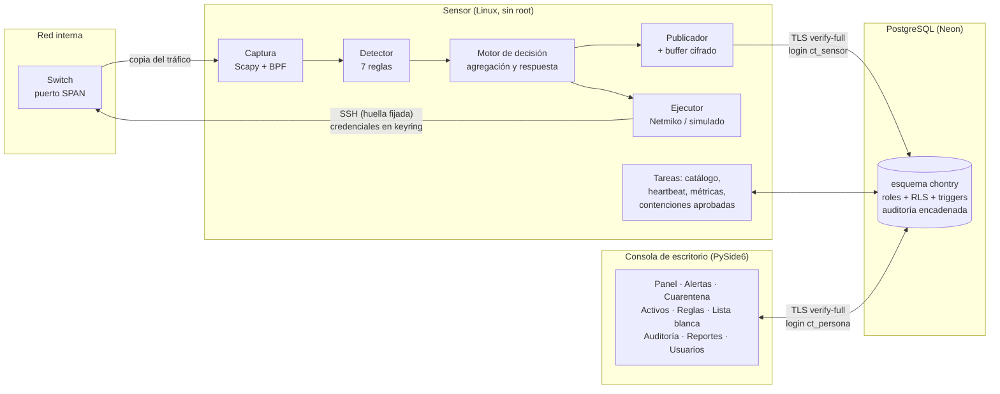
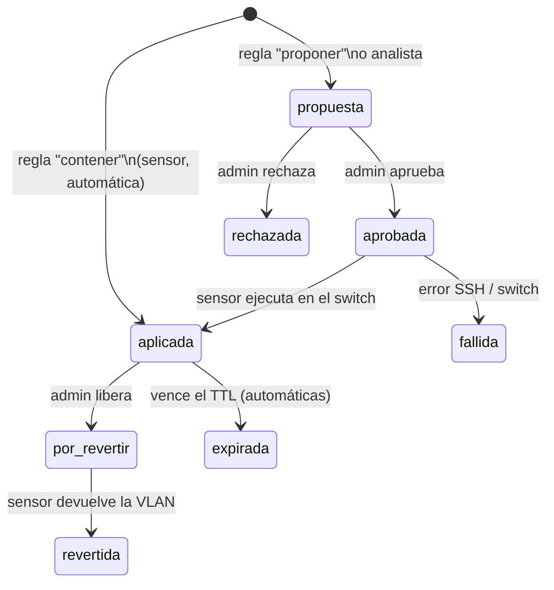

# Manual de funcionamiento — ChonTry

Describe **cómo funciona por dentro** ChonTry: la arquitectura, el flujo de los datos, las reglas de detección, el ciclo de una contención, la base de datos y los controles de seguridad, con su norma. Está pensado para el equipo técnico y para quien audite el sistema.

---

## 1. Qué es

ChonTry es un **IDS/IPS agentless** para **amenazas internas** en una LAN (por ejemplo, la red de una universidad):

- **Agentless:** no instala nada en los equipos. Escucha una **copia** del tráfico que el switch envía a un puerto espejo (**SPAN**).
- **IDS:** detecta reconocimiento (escaneos, barridos), movimiento lateral, fuerza bruta y suplantación (ARP, DHCP).
- **IPS:** contiene al atacante moviendo su puerto del switch a una **VLAN de cuarentena**, de forma automática (casos de alta confianza) o tras aprobación humana.

## 2. Arquitectura

Decisiones clave:

| Decisión | Por qué |
|---|---|
| Sensor y consola son **programas separados** que solo se comunican por la BD | La captura necesita privilegios de red; la interfaz no debe tenerlos nunca. Además no hay ningún servidor web expuesto (sin XSS, CSRF ni sesiones HTTP) |
| **Un login de BD por persona** + cuenta de la app (Argon2id + TOTP) | Para una app de escritorio, «el servidor» es la base de datos: si los permisos vivieran solo en la app, serían validación del lado del cliente. La BD aplica los roles y sabe quién hizo cada cosa (`session_user`) |
| El sensor **decide localmente** con un catálogo en caché | Si se cae la conexión, sigue detectando y conteniendo |
| Contención con **aprobación por defecto**, tope por hora, TTL y activos protegidos | Un atacante podría suplantar la IP de un servidor para que el IPS aísle a la víctima (DoS inducido) |

## 3. Estructura del código

| Carpeta | Contenido |
|---|---|
| `comun/` | Lo compartido: `db.py` (conexión TLS), `cripto.py` (Argon2id, AES-256-GCM, HKDF, TOTP), `validacion.py` (listas blancas, plantillas de comandos), `errores.py` (mensajes genéricos y logs limpios), `config.py`, `reglas_base.py` |
| `sensor/` | `detector.py` (reglas), `motor.py` (decisión), `publicador.py` (BD + buffer), `contencion.py` (switch), `catalogo.py`, `servicio.py` (orquestación), `__main__.py` |
| `consola/` | `acceso.py` (autenticación), `dialogos_acceso.py`, `repositorio.py` (backend real), `estado.py` + `simulador.py` (modo demostración), `vistas.py`, `ventana.py`, `tema.py` |
| `db/` | Migraciones `001`–`007` y sus pruebas SQL |
| `herramientas/` | `admin.py` (instalación de la BD), `laboratorio.py`, `generar_pcaps.py`, `buscar_secretos.py`, `capturas_consola.py` |
| `pruebas/` | Pruebas unitarias y de integración |
| `despliegue/` | Servicio systemd del sensor |

## 4. Flujo de una detección

1. **Captura.** Scapy recibe cada paquete del SPAN (filtro BPF opcional para descartar ruido, por ejemplo `not port 22`).
2. **Detección.** `Detector.procesar()` lo evalúa contra las 7 reglas usando **ventanas deslizantes** con el tiempo del paquete. Al pasar el umbral emite una `Deteccion` y vacía la ventana: una ráfaga produce un evento, no uno por paquete.
3. **Lista blanca.** Si el origen está exceptuado (IP, red o MAC; por regla o para todas; vigente), se descarta.
4. **Agregación.** Si ya hay una alerta abierta del mismo origen y regla dentro de la ventana (`deteccion.agregacion_seg`, 300 s), suma eventos, puertos y destinos y sube el puntaje (como máximo una actualización cada 10 s). Si no, crea una alerta nueva con un `uid` generado por el sensor.
5. **Evidencia.** Los paquetes de la ráfaga se guardan en formato **pcap**, se cifran con **AES-256-GCM** (subclave `evidencias`, con el `uid` de la alerta como dato asociado) y se registra el **SHA-256** del contenido original como cadena de custodia.
6. **Respuesta.** Ver la sección 6.
7. **Publicación.** Todo se escribe en la BD en lotes por transacción. Si la BD no responde, el lote se cifra y va al **buffer SQLite local** y se reenvía en orden al volver la conexión. El `uid` evita duplicados.

## 5. Reglas de detección

| Código | Detecta | Lógica | Umbral por defecto | Respuesta | MITRE |
|---|---|---|---|---|---|
| CT-SCAN-001 | Escaneo de puertos vertical | SYN sin ACK de un origen a **puertos distintos** de un mismo destino | 20 puertos / 10 s | Proponer | T1046 |
| CT-SCAN-002 | Barrido de hosts | ICMP echo o ARP who-has a **IPs distintas** | 30 hosts / 30 s | Proponer | T1018 |
| CT-SCAN-003 | Escaneo sigiloso | TCP con banderas NULL, FIN solo o FIN+PSH+URG (Xmas) | 5 paquetes / 10 s | **Contener** | T1046 |
| CT-LAT-001 | Movimiento lateral | SYN a SMB/RDP/WinRM/SSH (445, 3389, 5985, 5986, 22) hacia **hosts distintos** | 5 destinos / 300 s | **Contener** | T1021 |
| CT-AUTH-001 | Fuerza bruta | SYN repetidos al **mismo** destino y puerto de autenticación (22, 3389, 445, 21) | 30 conexiones / 60 s | Proponer | T1110 |
| CT-SPOOF-001 | Suplantación ARP | Una IP cambia de MAC en respuestas ARP | 2 cambios / 60 s | **Contener** | T1557.002 |
| CT-DHCP-001 | DHCP no autorizado | DHCPOFFER/ACK de un servidor que no está en la lista de autorizados | 1 respuesta | **Contener** | T1557.003 |

- Los umbrales y la activación de cada regla viven en `chontry.reglas_deteccion` y el sensor los recarga cada minuto.
- **Atribución en ARP spoofing:** se culpa a la MAC que suplanta. La referencia legítima es, en orden: la MAC registrada del **activo protegido** (por ejemplo, el gateway), una MAC que ya usa otra IP propia, o la primera MAC vista para esa IP. Así no se culpa al gateway aunque el sensor arranque en medio del ataque.
- **CT-DHCP-001** no se evalúa si no hay servidores autorizados configurados (lo avisa en el log).

## 6. Ciclo de vida de una contención

Antes de crear cualquier contención el motor comprueba:

| Comprobación | Si falla |
|---|---|
| El origen no es un **activo protegido** | No se contiene; se audita `contencion_omitida` |
| No hay ya una contención activa para esa MAC | No se duplica |
| Hay un switch para el host (el del activo, el del sensor o el único registrado) y se conoce su VLAN | Se audita `contencion_imposible` |
| El puerto del host se conoce (inventario o tabla MAC del switch por SSH) y **no es el puerto SPAN** | Se audita `contencion_imposible` |
| No se superó el **tope** de contenciones automáticas por hora (5) | Pasa a propuesta y requiere aprobación |

**Ejecución en el switch** (`sensor/contencion.py`):
- **Modo `simulado`** (por defecto): registra los comandos con la marca `[SIMULADO]` sin conectarse. Sirve para laboratorio y demostraciones.
- **Modo `real`**: antes de autenticarse, verifica la **huella SHA-256 de la llave SSH** del switch contra la registrada; si no coincide, no envía credenciales. Luego toma usuario y contraseña del **keyring** del sistema operativo y envía con Netmiko los comandos de la **plantilla** del fabricante (por ejemplo `interface Gi1/0/5` + `switchport access vlan 999`). Ningún valor se concatena sin validar.
- Las contenciones **automáticas** tienen TTL (60 min): al vencer, el sensor devuelve el puerto a su VLAN y marca `expirada`.

## 7. Base de datos

### 7.1 Tablas principales (esquema `chontry`)

| Tabla | Contenido |
|---|---|
| `usuarios`, `sesiones` | Cuentas de la consola (hash Argon2id, MFA cifrado, bloqueo), sesiones (solo el SHA-256 del token) |
| `sensores`, `metricas_sensor` | Sensores registrados, heartbeat, paquetes por segundo |
| `switches`, `segmentos_red`, `activos` | Infraestructura e inventario; `activos.protegido` |
| `reglas_deteccion`, `lista_blanca`, `configuracion` | Catálogo que usa el sensor |
| `alertas`, `evidencias`, `contenciones` | Resultado de la detección y la respuesta |
| `auditoria` | Registro de solo anexado con cadena SHA-256 |
| `reportes`, `schema_migraciones` | Reportes exportados con su hash; versiones aplicadas |

### 7.2 Roles y permisos

| Rol de BD | Lo usa | Permisos clave |
|---|---|---|
| `chontry_sensor` | Sensor | Leer el catálogo; insertar alertas, evidencias, métricas, activos; actualizar solo columnas de agregación; transiciones de contención permitidas (ver 6). **No ve usuarios** |
| `chontry_consola` | Analista | Leer todo **menos** hashes, MFA y correos; cambiar estado de alertas; proponer contenciones; editar su propia cuenta (RLS) |
| `chontry_admin` | Administrador | Lo del analista + aprobar/rechazar/liberar, reglas, lista blanca, activos, usuarios |
| `chontry_auditor` | Auditor | Solo lectura, verificar auditoría, reportes, su propia cuenta |

Defensa en profundidad en la BD:
- **RLS** en `usuarios` y `sesiones`: cada quien edita solo su cuenta y sus sesiones.
- **Triggers:** un analista no puede aprobar; el sensor solo hace transiciones válidas; nunca se aísla el puerto SPAN; los campos forenses de una alerta son inmutables y las alertas no se borran.
- **Funciones `SECURITY DEFINER`** con `search_path` fijo: `mis_credenciales()` (solo la cuenta del login conectado), `registrar_login()` (intentos y bloqueo), `consumir_totp()` (código de un solo uso), `verificar_auditoria()`.
- **CHECK** de lista blanca en todo lo que termina en un comando (interfaces, filtro BPF, fabricante, huella SSH).

### 7.3 Auditoría encadenada

Cada cambio en tablas sensibles lo registra un trigger con el **actor real** (`session_user`), sin contraseñas, secretos, correos ni contenido cifrado. Cada registro guarda `hash = SHA-256(hash_anterior || contenido)`. Los triggers rechazan `UPDATE`, `DELETE` y `TRUNCATE`. `verificar_auditoria()` recalcula la cadena y devuelve los registros alterados o huérfanos. Los reportes guardan el último hash como ancla externa.

## 8. Criptografía y secretos

| Qué | Cómo | Dónde |
|---|---|---|
| Contraseñas | Argon2id (t=3, m=64 MiB, p=4), rehash automático si cambian los parámetros | `comun/cripto.py` |
| Segundo factor | TOTP RFC 6238, ±1 paso, **un solo uso** (`consumir_totp`) | `comun/cripto.py`, `consola/acceso.py`, migración 007 |
| Evidencias, MFA, buffer, caché | AES-256-GCM, nonce de 96 bits aleatorio, subclave HKDF-SHA256 por propósito, AAD = uid de la alerta | `comun/cripto.py` |
| Tránsito | TLS con `sslmode=verify-full` + `channel_binding=require` y CA de certifi (solo se exceptúa `localhost`) | `comun/db.py` |
| Credenciales del switch | Keyring del sistema operativo | `herramientas/admin.py`, `sensor/contencion.py` |
| Clave maestra | Variable `CHONTRY_CLAVE_MAESTRA` o keyring; nunca en la BD ni en el repositorio | `.env` (en `.gitignore`) |

## 9. Trazabilidad normativa

| Control | Norma |
|---|---|
| Segmentación y VLAN de cuarentena; captura pasiva por SPAN; puerto SPAN protegido | ISO/IEC 27033-2 (diseño de seguridad de red) |
| Validación positiva en app y BD; plantillas de comandos; CSV sin fórmulas | OWASP ASVS V5 (validación) |
| Argon2id, política de longitud, bloqueo, mensajes genéricos, TOTP de un solo uso | OWASP ASVS V2 (autenticación) |
| Sesiones con token hasheado, expiración, cierre por inactividad y revocación | OWASP ASVS V3 (sesiones) |
| Roles de BD, RLS, triggers, «el servidor es la BD» | OWASP ASVS V4 (control de acceso) |
| AES-256-GCM, HKDF, CSPRNG | OWASP ASVS V6 (criptografía) |
| Mensajes genéricos, logs sin secretos, auditoría encadenada | OWASP ASVS V7 (errores y registro) |
| TLS verify-full, pinning de llave SSH | OWASP ASVS V9 (comunicaciones) |
| Pruebas automáticas, Bandit, pip-audit, búsqueda de secretos en CI | NIST SSDF PW.7, PW.8 |
| Dependencias con versión fija y auditadas | NIST SSDF PW.4 |
| Configuración segura por defecto (modo simulado, aprobación, mínimo privilegio, sin root) | NIST SSDF PW.9 |
| Secretos fuera del repositorio; `.gitignore`; escáner de secretos | NIST SSDF PS.1 |

(Numeración de capítulos de ASVS según la guía del curso.)

## 10. Calidad y verificación

- **55 pruebas automáticas** (`pruebas/`): validación, criptografía, detector (cada regla y su ausencia en tráfico normal), motor (agregación, lista blanca, protegidos, tope, SPAN), estado de demostración y **8 pruebas de integración** contra PostgreSQL real (sensor → BD → consola por roles → sensor ejecuta → auditoría íntegra).
- **CI en GitHub Actions** (`.github/workflows/ci.yml`): pruebas con un PostgreSQL 17 de servicio, Bandit, pip-audit y búsqueda de secretos en cada cambio.
- **Bandit:** 0 hallazgos altos o medios; los de severidad baja son `random` usado solo para simular tráfico (falso positivo documentado).
- **pip-audit:** sin vulnerabilidades conocidas en las versiones fijadas (se actualizaron `cryptography`, `certifi` y `scapy` al detectarlas el 2026-11-10).

## 11. Limitaciones conocidas

- Las reglas son **heurísticas por umbral**: un escaneo muy lento (por debajo del umbral en la ventana) no se detecta. Los umbrales se ajustan por red.
- La contención real está probada en modo simulado y con pruebas unitarias. **La validación contra un switch físico o de GNS3/EVE-NG está pendiente** (depende del laboratorio de la universidad).
- La resolución automática del puerto por SSH (`show mac address-table`) solo está implementada para Cisco. En otros fabricantes, el puerto se toma del inventario (Activos).
- Las plantillas de cuarentena existen para `cisco_ios`, `cisco_nxos` y `hp_procurve`.
- Se asume **un sensor que ejecuta** las contenciones por switch. Con varios sensores en el mismo switch habría que repartir esa responsabilidad.
- La captura en vivo en Windows requiere Npcap y privilegios de administrador; en producción se recomienda Linux con capacidades.
- El dueño de la base de datos podría desactivar triggers: por eso la app nunca usa ese rol y los reportes guardan el último hash como ancla externa.
