# Manual de usuario — Consola ChonTry

Este manual es para quien usa la consola todos los días: administradores, analistas y auditores. Para instalarla, vea el [manual de instalación](manual_instalacion.md).

---

## 1. Iniciar sesión

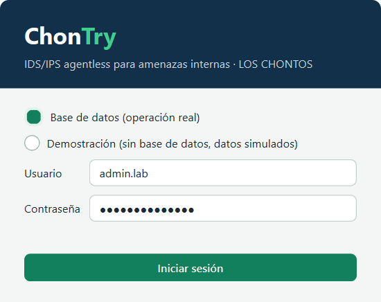

1. Abra **ChonTry.bat** (o `python -m consola`).
2. Deje marcada **Base de datos (operación real)**, escriba su usuario y su contraseña y pulse **Iniciar sesión**.
3. Escriba el **código de 6 dígitos** de su app autenticadora.

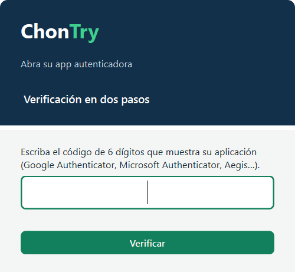

- Si algo falla verá siempre «Credenciales inválidas.»: por seguridad no se dice si el usuario existe o si la contraseña es la errada.
- Tras **5 intentos fallidos** la cuenta se bloquea **15 minutos**. Un administrador puede desbloquearla antes.
- Cada código TOTP sirve **una sola vez**. Si ve «Ese código ya se usó», espere el siguiente.
- La opción **Demostración** abre la consola con datos simulados en memoria. Sirve para presentaciones y no toca la base de datos.

### Primer ingreso

La primera vez (o si un administrador lo exige) la consola pide:

1. **Cambiar la contraseña temporal.** Debe tener al menos 12 caracteres, no contener su usuario y no ser una contraseña común. Una frase larga es mejor que una palabra con símbolos.

   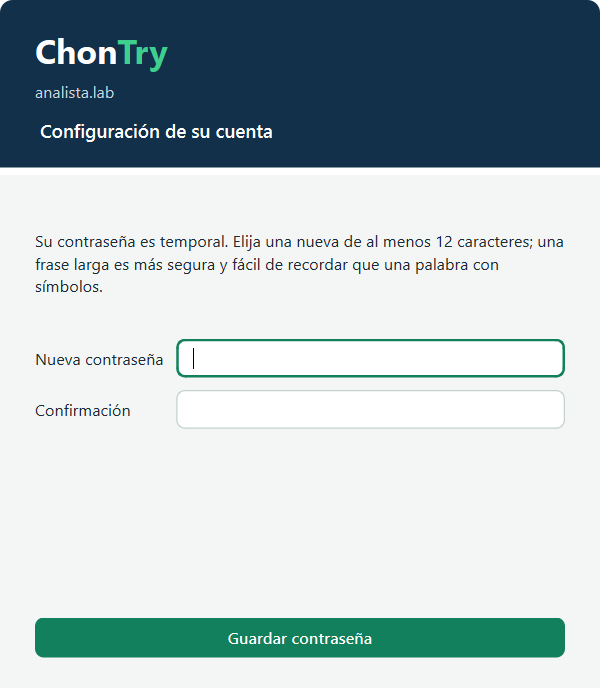

2. **Activar la verificación en dos pasos.** Escanee el QR con Google Authenticator, Microsoft Authenticator o Aegis (o escriba la clave manual) y confirme con el código de 6 dígitos.

   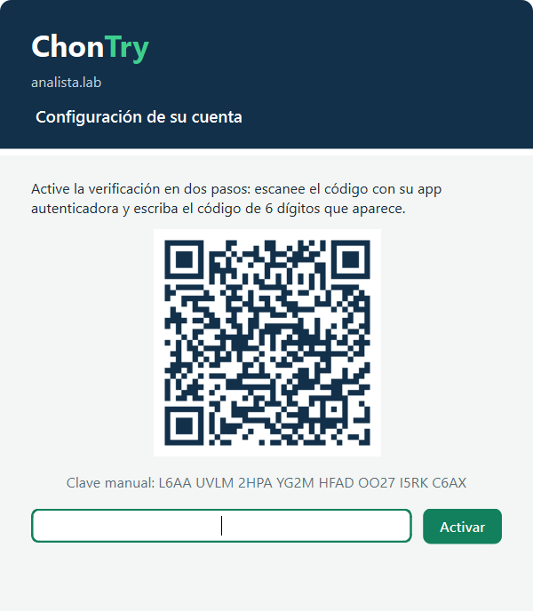

### Cerrar sesión

Use **Cerrar sesión** (arriba a la derecha). La sesión también se cierra sola tras **15 minutos sin actividad**, si vence (8 horas) o si un administrador la cierra desde Usuarios. Todo queda registrado en la auditoría.

## 2. La pantalla principal

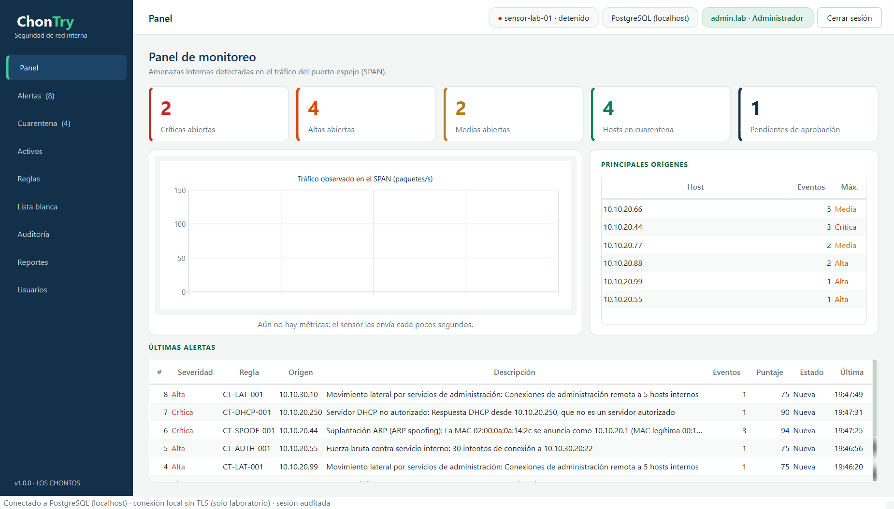

- **Barra lateral (azul):** las secciones. Alertas y Cuarentena muestran entre paréntesis cuántas hay abiertas.
- **Encabezado:** estado del sensor (verde = reportó hace menos de 2 minutos; rojo = sin reporte o detenido), la base de datos conectada y su usuario y rol.
- **Barra inferior:** tipo de conexión (TLS verificado o laboratorio local).
- Si se pierde la conexión con la base de datos aparece un **aviso naranja** y la consola reintenta sola.

## 3. Secciones

### 3.1 Panel
Resumen de la red: alertas críticas, altas y medias abiertas, hosts en cuarentena, propuestas pendientes de aprobación, tráfico del puerto SPAN (paquetes por segundo), los equipos más sospechosos y las últimas alertas.

### 3.2 Alertas

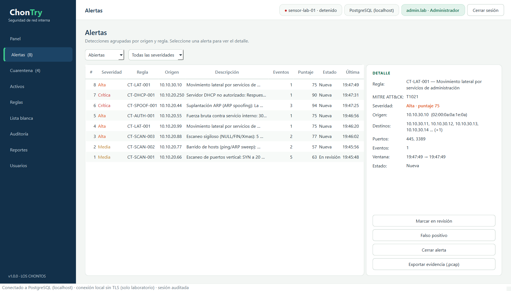

Cada alerta agrupa los eventos repetidos del **mismo origen y la misma regla** (por ejemplo, un escaneo de 100 puertos es una sola alerta con varios eventos).

- **Filtros:** por estado (Abiertas por defecto) y por severidad.
- **Detalle:** regla, técnica MITRE ATT&CK, origen (IP y MAC), destinos, puertos, número de eventos y ventana de tiempo.
- **Acciones** (administrador y analista):
  - **Marcar en revisión** — alguien la está investigando.
  - **Falso positivo** — no era un ataque (por ejemplo, una herramienta autorizada; considere agregarla a la lista blanca).
  - **Cerrar alerta** — atendida.
  - **Exportar evidencia (.pcap)** — descifra los paquetes que originaron la alerta, comprueba su SHA-256 y los guarda para abrirlos en Wireshark. Requiere la clave maestra en el equipo. La exportación queda auditada.

Severidades: **Crítica** (suplantación ARP, DHCP falso), **Alta** (escaneo sigiloso, movimiento lateral, fuerza bruta), **Media** (escaneo de puertos, barrido de hosts).

### 3.3 Cuarentena

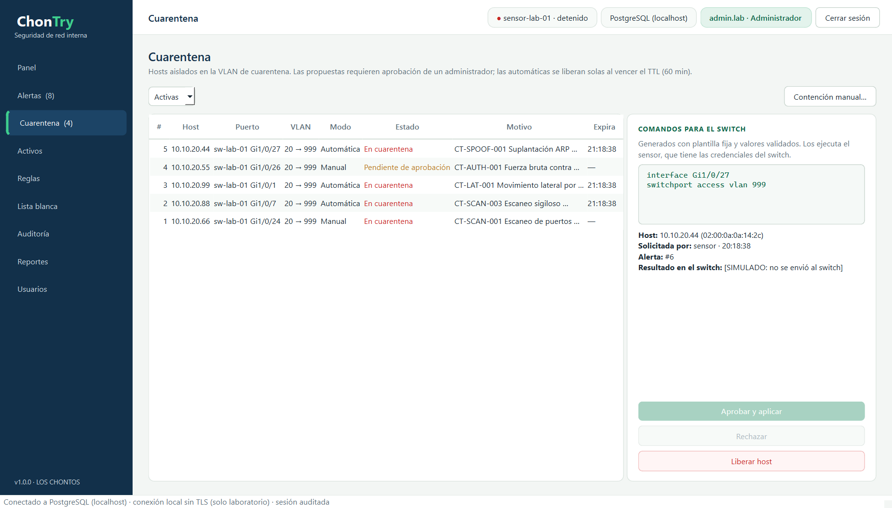

Muestra los hosts aislados en la VLAN de cuarentena y las propuestas.

| Estado | Significado |
|---|---|
| Pendiente de aprobación | El sensor o un analista propuso aislar el host; espera a un administrador |
| Aprobada (enviando) | Un administrador aprobó; el sensor está aplicando el cambio en el switch |
| En cuarentena | El puerto del host está en la VLAN de cuarentena |
| Liberación pendiente | Un administrador pidió liberar; el sensor está devolviendo el puerto a su VLAN |
| Liberada / Liberada (TTL) | El host volvió a su VLAN (manualmente o porque venció el tiempo de 60 min de una contención automática) |
| Rechazada / Fallida | No se aplicó (decisión de un administrador o error en el switch; el error se muestra en el detalle) |

- **Comandos para el switch:** los comandos exactos que se envían, generados con una plantilla fija.
- **Aprobar y aplicar / Rechazar / Liberar host:** solo administradores.
- **Contención manual…** (administrador y analista): proponer aislar un host del inventario. Los campos se validan mientras escribe: una IP mal escrita o un puerto con caracteres extraños (`Gi1/0/1; reload`) se marcan en rojo y se rechazan.

  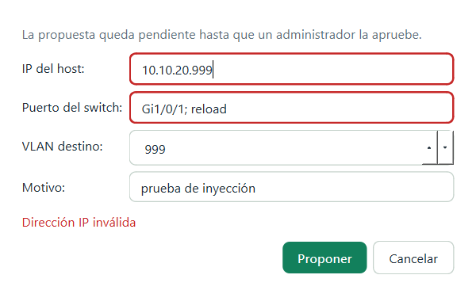

Reglas de seguridad que la consola **no** deja romper (y la base de datos tampoco):
- Un **activo protegido** (gateway, DNS, controlador de dominio) nunca se aísla.
- El **puerto SPAN** del sensor nunca se aísla (dejaría ciego al IDS).
- Un host solo puede tener **una** contención activa.
- Un analista **propone**, pero solo un administrador **aprueba**.

### 3.4 Activos

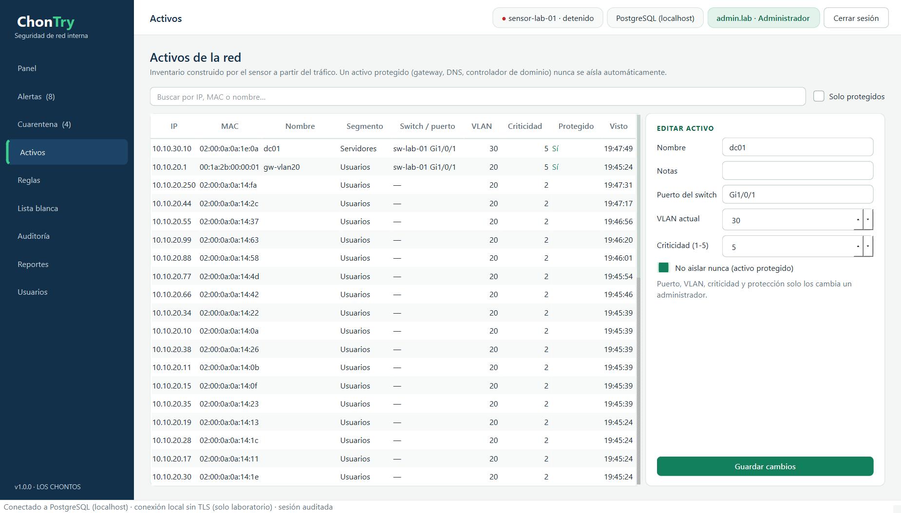

Inventario que construye el sensor a partir del tráfico (IP, MAC, segmento, switch y puerto, VLAN, criticidad).
- El analista puede editar **nombre** y **notas**.
- El administrador además define **puerto**, **VLAN**, **criticidad** y marca **«No aislar nunca»** (activo protegido).

### 3.5 Reglas

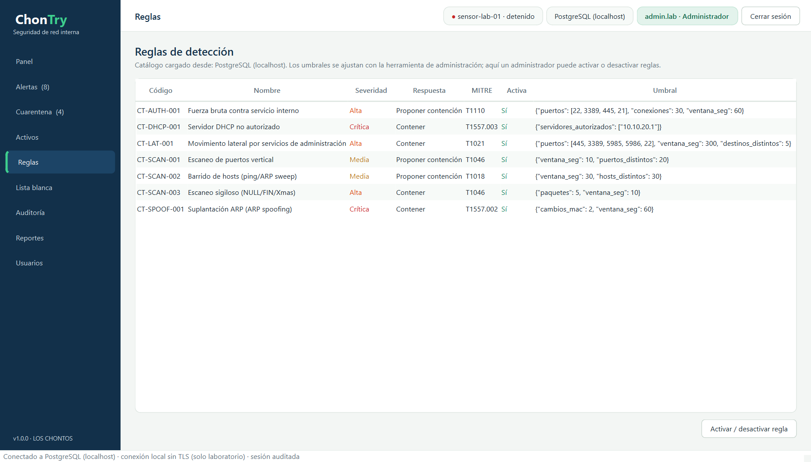

Las 7 reglas de detección, con su severidad, la respuesta (solo alertar, proponer contención o contener) y el umbral. Un administrador puede **activar o desactivar** una regla; los umbrales se cambian con la herramienta de administración.

### 3.6 Lista blanca

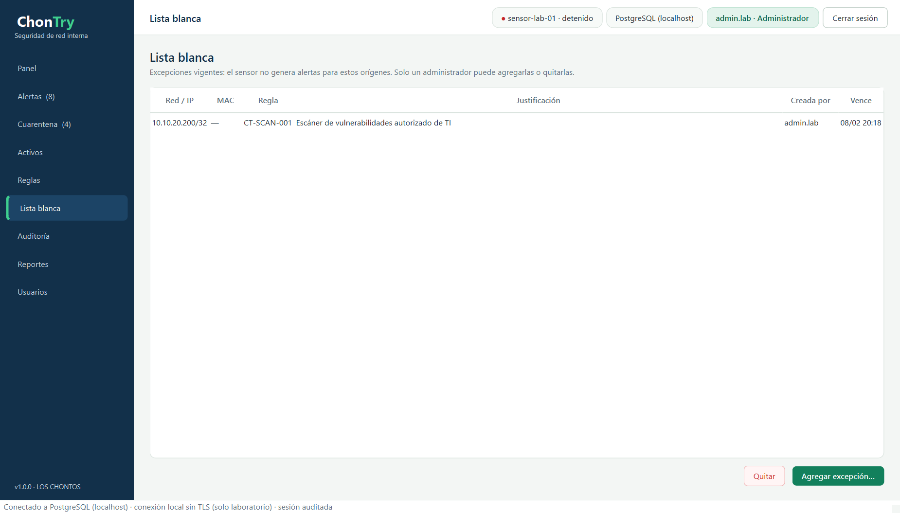

Excepciones para herramientas **autorizadas** (por ejemplo, el escáner de vulnerabilidades de TI). El administrador indica la IP, red o MAC, para qué regla aplica (o todas), una justificación y la vigencia en días. El sensor no genera alertas para esos orígenes.

### 3.7 Auditoría

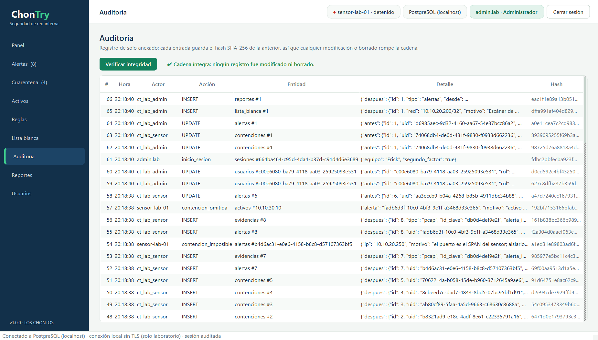

Registro de todo lo que pasa: inicios y cierres de sesión, cambios de alertas, aprobaciones, acciones del sensor, exportaciones. **Nadie puede modificarlo ni borrarlo**, ni siquiera un administrador: la base de datos lo impide.

- **Verificar integridad** recalcula la cadena de hashes SHA-256. Si alguien hubiera modificado o borrado un registro directamente en la base de datos, se indica en cuál.
- En el modo demostración hay un botón para **simular** una manipulación y ver cómo se detecta:

  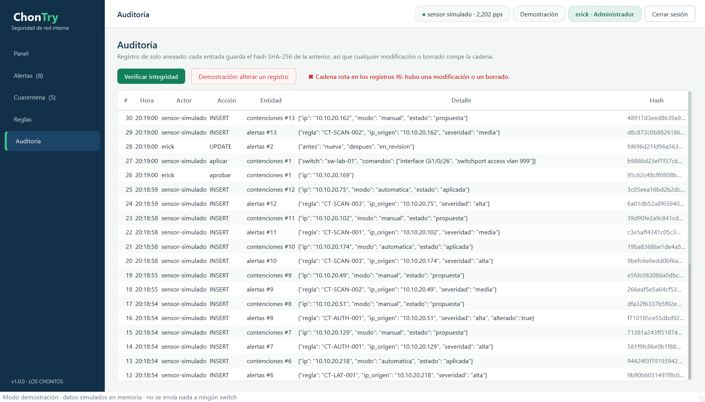

### 3.8 Reportes

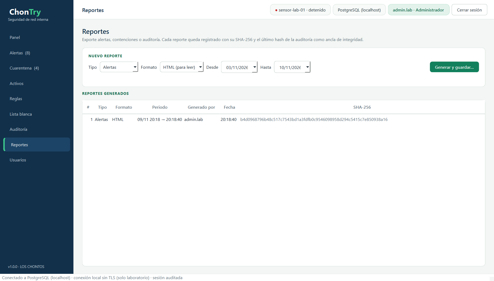

Exporte **alertas**, **contenciones** o **auditoría** de un periodo, en **HTML** (para leer o imprimir) o **CSV** (para Excel). Cada reporte:
- queda registrado con su **SHA-256**, para poder demostrar después que no se alteró;
- incluye el último hash de la auditoría como **ancla de integridad**;
- en CSV, protege las celdas para que no se ejecuten fórmulas al abrirlo en Excel.

### 3.9 Usuarios (solo administradores)

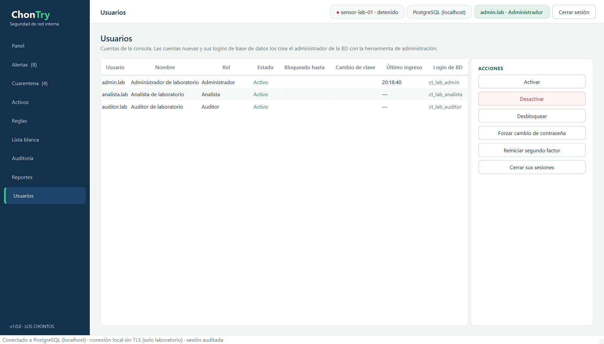

| Acción | Para qué |
|---|---|
| Activar / Desactivar | Habilitar o impedir el acceso de una cuenta |
| Desbloquear | Quitar el bloqueo por intentos fallidos |
| Forzar cambio de contraseña | La persona deberá cambiarla en su próximo ingreso |
| Reiniciar segundo factor | Si perdió el teléfono: en el próximo ingreso registrará un nuevo QR |
| Cerrar sus sesiones | Cierra de inmediato las sesiones abiertas de esa persona |

Las cuentas nuevas las crea el administrador de la base de datos con la herramienta de administración (cada persona necesita su propio login de BD).

## 4. Qué puede hacer cada rol

| Acción | Administrador | Analista | Auditor |
|---|:-:|:-:|:-:|
| Ver panel, alertas, cuarentena, activos, reglas, lista blanca y auditoría | ✔ | ✔ | ✔ |
| Cambiar el estado de una alerta | ✔ | ✔ | — |
| Proponer una contención manual | ✔ | ✔ | — |
| Aprobar, rechazar o liberar contenciones | ✔ | — | — |
| Editar nombre y notas de activos | ✔ | ✔ | — |
| Marcar activos protegidos, puerto y VLAN | ✔ | — | — |
| Activar o desactivar reglas; lista blanca | ✔ | — | — |
| Exportar evidencias y reportes; verificar la auditoría | ✔ | ✔ | ✔ |
| Administrar usuarios | ✔ | — | — |

Estos permisos no dependen solo de la interfaz: los aplica la **base de datos** (roles, seguridad por filas y triggers). Aunque alguien modificara la aplicación, la base de datos rechazaría la acción.

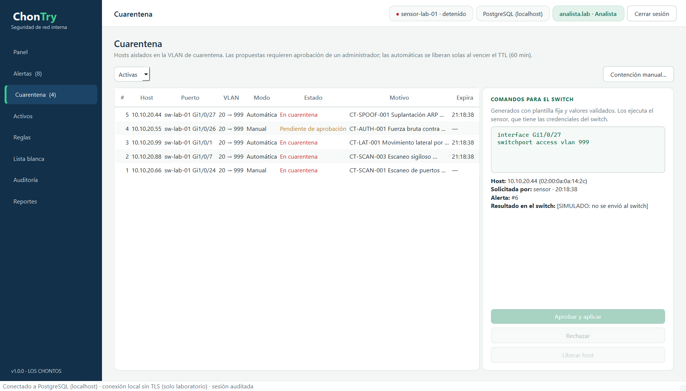

## 5. Preguntas frecuentes

**¿Por qué una alerta no se aisló sola?** Solo las reglas de alta confianza contienen automáticamente (escaneo sigiloso, movimiento lateral, suplantación ARP, DHCP falso). Las demás se **proponen**. Tampoco se aísla automáticamente si ya hubo 5 contenciones automáticas en la última hora (tope anti-abuso): pasa a propuesta.

**¿Qué pasa si se cae internet?** El sensor sigue detectando y guarda todo cifrado en un buffer local; lo sube cuando vuelve la conexión. La consola muestra un aviso y reintenta sola.

**¿Dónde están los errores técnicos?** En `datos/consola.log` y `datos/sensor.log`. Al usuario solo se le muestra un mensaje genérico con un código para buscarlo en el log. Los logs nunca contienen contraseñas, tokens ni correos.
